# Projet de fin de module — Cloud Intelligence

## Conception d'une architecture cloud universitaire et mise en œuvre d'un laboratoire OpenStack

**Étudiant :** Mohamed Iliass KADDAR  
**Identifiant étudiant :** imk25  
**Enseignant :** C. EL AMRANI  
**Date :** 14 novembre 2026

> Ce rapport décrit les quatre parties du projet et leurs résultats dans l'environnement de laboratoire utilisé. Les éléments d'architecture de la partie 1 sont des propositions ; les captures et sorties de commandes montrent le laboratoire réellement exécuté. Les limites de mesure sont indiquées pour éviter de présenter les hypothèses comme des faits ou des garanties de capacité.

## Résumé

Le projet comprend :

1. Une simulation CloudSim Plus d'un service cloud universitaire distribué entre deux datacenters logiques, avec workloads normaux et de pointe, comparaison de deux ordonnanceurs, autoscaling horizontal, mesures de performance et estimation de coût.
2. Un laboratoire DevStack local : vérification des services OpenStack, création d'un réseau IaaS, accès SSH à une instance CirrOS et déploiement d'une application Web Flask sur Ubuntu.
3. Le provisionnement d'une instance Web par Terraform, puis sa configuration avec Ansible et Nginx.
4. La définition d'un SLA de disponibilité et son contrôle par un script Python utilisant Keystone, Nova et un test TCP/SSH, y compris pendant une panne provoquée.

La simulation termine les tâches synthétiques dans tous les scénarios. En pointe, l'autoscaling améliore le temps de réponse moyen du modèle, mais augmente son coût estimé. La charge n'étant pas calibrée sur des requêtes réellement mesurées, ces résultats ne certifient pas la capacité d'une infrastructure universitaire réelle.

# 1. Environnement de travail et accès au laboratoire

## 1.1 Machine et virtualisation

Conformément à la consigne du projet, DevStack est installé dans une machine virtuelle locale, et non chez un fournisseur cloud externe.

| Élément | Configuration |
|---|---|
| Machine hôte | Ordinateur personnel sous Ubuntu, utilisé avec VS Code |
| Hyperviseur | Oracle VirtualBox |
| VM de laboratoire | Ubuntu Server 26.04.1 LTS |
| Ressources de la VM | 4 vCPU, 12 Go de RAM, environ 68 Go de disque |
| Plateforme OpenStack | DevStack, branche `stable/2026.2` |
| Réseau OpenStack | Neutron avec OVN |
| Utilisateur Linux sur la VM | `stack` pour les commandes DevStack et OpenStack |
| Utilisateur depuis l'hôte | `imk` |
| Adresse de gestion de la VM | `192.168.56.101` sur l'interface Host-only |

La VM VirtualBox possède deux interfaces réseau :

- **Adaptateur 1 — NAT :** accès Internet sortant depuis la VM.
- **Adaptateur 2 — Host-only :** liaison privée entre Ubuntu hôte et VM. L'adresse IPv4 de gestion de la VM a été fixée à `192.168.56.101` afin que SSH et Horizon restent accessibles à la même adresse après un redémarrage.

L'adresse `192.168.56.101` est l'adresse de gestion Host-only de la VM. Elle est distincte du réseau flottant OpenStack `172.24.4.0/24`. Le script [`scripts/fix-net.sh`](./scripts/fix-net.sh) ne configure pas l'adresse Host-only : il rétablit après redémarrage l'interface externe `br-ex` de DevStack et le routage/NAT des adresses flottantes.

## 1.2 Connexion SSH depuis Ubuntu hôte

Depuis un terminal de l'ordinateur Ubuntu hôte :

```bash
ssh imk@192.168.56.101
sudo -u stack -i
cd ~/devstack
source openrc admin admin
```

La première commande ouvre une session Linux sur la VM. La seconde passe à l'utilisateur `stack`, qui dispose de l'environnement DevStack. La commande `source openrc admin admin` charge les variables d'authentification nécessaires à la CLI OpenStack. Horizon est accessible depuis l'hôte à `http://192.168.56.101/dashboard` avec l'utilisateur OpenStack `admin`.

Après un redémarrage, la connectivité flottante de DevStack peut nécessiter la restauration de `br-ex` :

```bash
~/fix-net.sh
```

Le script remet `172.24.4.1/24` sur `br-ex`, active l'interface et le forwarding IPv4, puis ajoute une règle de masquerading si elle est absente. Il ne modifie pas l'adresse de gestion `192.168.56.101`.

## 1.3 Accès aux applications Web depuis l'hôte

Les adresses flottantes de DevStack sont dans un réseau privé au laboratoire. Pour afficher les applications depuis le navigateur de l'hôte, j'ai utilisé des tunnels SSH passant par la VM DevStack :

```bash
# Part 2 : application Flask de vm-saas
ssh -L 8080:172.24.4.40:5000 imk@192.168.56.101
# Navigateur hôte : http://localhost:8080

# Part 3 : Nginx de vm-terraform
ssh -L 8081:172.24.4.84:80 imk@192.168.56.101
# Navigateur hôte : http://localhost:8081
```

Le tunnel écoute sur le port local choisi (8080 ou 8081) et relaie le trafic à travers SSH vers l'adresse flottante et le port de l'instance concernée.

# 2. Partie 1 — Simulation d'un cloud universitaire avec CloudSim Plus

## 2.1 Recherche sur l'Université Abdelmalek Essaâdi

Le relevé utilisé est issu du site officiel de l'UAE et est conservé dans [`scrapping-uae-data/data/uae_research.md`](./scrapping-uae-data/data/uae_research.md). Il indique notamment :

| Indicateur publié | Valeur relevée |
|---|---:|
| Étudiants, doctorants inclus | 130 750 |
| Enseignants-chercheurs permanents | 1 357 |
| Personnel administratif et technique | 598 |
| Facultés | 10 |
| Écoles | 7 |
| Provinces/préfectures couvertes selon le site | 6 |

Le nombre d'étudiants est **130 750**. Pour le modèle de plateforme, j'ajoute les deux catégories de personnels publiées : `130 750 + 1 357 + 598 = 132 705 utilisateurs potentiels estimés`. Il ne s'agit pas d'un nombre vérifié de comptes Moodle ni d'utilisateurs simultanés.

Les profils d'établissements extraits citent les localités de Tanger, Tétouan, Larache, Al Hoceima et Ksar El Kebir. La page synthétique annonce six provinces/préfectures ; le relevé ne permet pas de confirmer six villes d'implantation. Les données détaillées comportent des valeurs répétées ou difficiles à interpréter et leur somme ne reconstitue pas le total universitaire. Elles ne servent donc pas à établir l'effectif global.

Le site public présente des services ou ressources numériques tels que Moodle, GCDoc pour le doctorat, l'Archive ouverte et des ressources électroniques. Le portail d'inscriptions, la messagerie et les examens en ligne sont considérés dans le présent projet comme des services possibles à héberger, et non comme des systèmes dont la charge de production aurait été mesurée.

**Qualité des données :** le scrape a été enregistré le 8 novembre 2026 et signale que la vérification TLS était désactivée. Les chiffres universitaires n'ont pas de date de référence affichée. Les valeurs sont donc reprises comme valeurs publiées, à confirmer sur le site officiel avant toute décision de production. Les détails et règles d'interprétation sont dans [`scrapping-uae-data/data-quality/problemes.md`](./scrapping-uae-data/data-quality/problemes.md) et [`scrapping-uae-data/dataquality.md`](./scrapping-uae-data/dataquality.md).

## 2.2 Architecture proposée

Je propose deux pôles privés, à Tanger et Tétouan, afin de répartir les services et de rapprocher les ressources des établissements. La répartition **55 % Ouest / 45 % Est** est une hypothèse de dimensionnement, pas une statistique officielle du trafic.

| Élément proposé | Tanger — pôle Ouest | Tétouan — pôle Est |
|---|---:|---:|
| Datacenter logique | 1 | 1 |
| Hôtes simulés | 8 | 6 |
| Capacité d'un hôte | 16 PE, 10 000 MIPS/PE, 64 GiB RAM, 1 TB de stockage, 10 Gbps | Identique |
| VM applicatives initiales | 6 | 4 |
| Profil d'une VM applicative | 4 vCPU à 2 500 MIPS/PE, 8 GiB RAM, 50 GB de stockage | Identique |
| Part de workload affectée | 55 % | 45 % |

Le site Tanger (Cité de l'Innovation/FST) et le site Tétouan (Techno-Centre) sont des **emplacements proposés** dans les notes d'architecture ; ils ne sont pas présentés comme des datacenters UAE existants. Un répartiteur/DNS distribuerait le trafic entre les pôles. Une base de données répliquée, sauvegardes et PRA inter-sites seraient à prévoir dans un déploiement complet. Le profil de VM base de données suggéré dans la note d'architecture est de 8 vCPU, 16 GiB RAM et 200 GB de stockage ; il n'est pas modélisé dans la simulation actuelle.

### Modèles de service et de déploiement

- **IaaS :** OpenStack fournit les VM, réseaux, volumes, images, règles de sécurité et capacités de stockage.
- **PaaS :** des environnements applicatifs et bases de données gérés (par exemple des services conteneurisés) pourraient être mis à disposition des équipes.
- **SaaS :** Moodle, portail étudiant, messagerie, inscriptions, bibliothèque numérique et examens en ligne seraient utilisés directement par les étudiants et le personnel.
- **Déploiement hybride proposé :** cloud privé pour les données sensibles et la charge de base ; extension vers un cloud public en période de pointe, sous réserve d'étudier sécurité, coûts, réseau et conformité.

Le scénario hybride et le bursting public sont des recommandations d'architecture. **Ils ne sont pas exécutés par CloudSim** : le simulateur représente deux datacenters logiques et leurs VM, sans fournisseur public, liaison inter-datacenter, réplication réelle, latence réseau ou mécanisme de PRA.

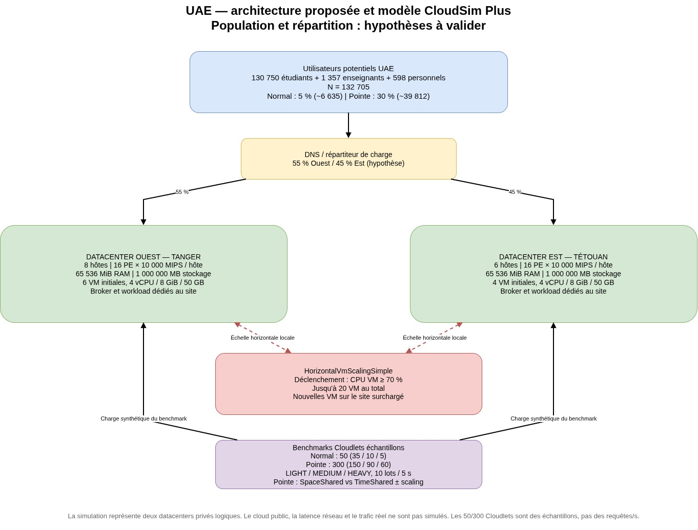

Le fichier Draw.io source modifiable est [`part1-cloudsim/architecture.drawio`](./part1-cloudsim/architecture.drawio).

## 2.3 Modélisation de la charge

Chaque Cloudlet est une tâche CPU mono-cœur. Les tailles et profils de requêtes sont synthétiques, faute de mesures de production.

| Profil | Longueur | Entrée / sortie | Durée CPU théorique isolée à 2 500 MIPS |
|---|---:|---:|---:|
| LIGHT | 5 000 MI | 50 / 150 KiB | 2 s |
| MEDIUM | 20 000 MI | 300 / 300 KiB | 8 s |
| HEAVY | 50 000 MI | 1 000 / 2 000 KiB | 20 s |

| Période | Simultanéité supposée parmi 132 705 utilisateurs potentiels | Échantillon simulé | Mix |
|---|---:|---:|---|
| Normale | 5 %, soit environ 6 635 personnes | 50 Cloudlets | 35 LIGHT, 10 MEDIUM, 5 HEAVY |
| Pointe | 30 %, soit environ 39 812 personnes | 300 Cloudlets | 150 LIGHT, 90 MEDIUM, 60 HEAVY |

Les utilisateurs actifs estimés ne sont **pas** convertis en autant de Cloudlets. Les 50 et 300 Cloudlets servent uniquement à comparer le comportement du modèle. Ils ne signifient ni 50/300 requêtes par seconde, ni une requête mesurée par utilisateur. Chaque lot est réparti en dix arrivées, espacées de cinq secondes.

## 2.4 Scénarios et résultats

Les VM utilisent chacune un ordonnanceur distinct. Le scénario de pointe compare d'abord `CloudletSchedulerSpaceShared` à `CloudletSchedulerTimeShared`, puis compare le TimeShared fixe à l'autoscaling horizontal avec seuil CPU de 70 % et maximum de 20 VM.

| Scénario | Cloudlets terminées | VM créées | Réponse moyenne | Makespan | Utilisation moyenne des hôtes | Coût estimé |
|---|---:|---:|---:|---:|---:|---:|
| Normal — TimeShared | 50 / 50 | 10 | 5,10 s | 56,76 s | 0,54 % | 0,032366 $ |
| Pointe — SpaceShared sans scaling | 300 / 300 | 10 | 11,36 s | 81,37 s | 3,57 % | 0,046372 $ |
| Pointe — TimeShared sans scaling | 300 / 300 | 10 | 11,73 s | 76,11 s | 3,72 % | 0,043376 $ |
| Pointe — TimeShared avec scaling | 300 / 300 | 20 | 7,54 s | 65,40 s | 4,57 % | 0,073594 $ |

Le dernier scénario crée 10 VM supplémentaires. Par rapport au scénario de pointe TimeShared fixe, il réduit le temps de réponse moyen d'environ **36 %** (11,73 à 7,54 s) et le makespan d'environ **14 %** (76,11 à 65,40 s), pour un coût estimé supérieur d'environ **70 %**. Les deux ordonnanceurs à capacité fixe ont des résultats différents : SpaceShared a une attente moyenne de file de 3,87 s, alors qu'elle est nulle dans ce run TimeShared, mais son makespan est plus long.

Le coût est illustratif : il applique les tarifs configurés à la durée de vie simulée des VM, sans représenter un devis OpenStack ou fournisseur public. L'utilisation CPU moyenne est calculée sur l'ensemble des 14 hôtes, y compris ceux peu sollicités ; elle ne représente pas uniquement l'utilisation des VM actives.

### Conclusion sur la capacité en période de pointe

**Pour le workload synthétique testé**, les 300 Cloudlets finissent dans les deux datacenters et le scaling améliore les métriques de temps au prix d'un coût supérieur. **Il n'est pas possible de conclure que l'architecture supportera réellement 39 812 utilisateurs simultanés.** Il faudrait mesurer la fréquence réelle des requêtes, leur intensité CPU et leur répartition, calibrer les Cloudlets sur Moodle ou une application réelle, puis effectuer une analyse de sensibilité.

Les résultats complets sont dans [`part1-cloudsim/benchmark_results.csv`](./part1-cloudsim/benchmark_results.csv) ; le détail des paramètres et la procédure de reproduction figurent dans [`part1-cloudsim/guide.md`](./part1-cloudsim/guide.md).

# 3. Partie 2 — OpenStack : IaaS et SaaS

## 3.1 Vérification de DevStack

Depuis la session SSH ouverte sur la VM :

```bash
cd ~/devstack
source openrc admin admin
openstack service list
openstack compute service list
openstack network agent list
```

Les sorties capturées montrent les services compute, placement, identity, image, block-storage et network. Les rôles principaux sont :

| Service | Rôle |
|---|---|
| Keystone | Identité, authentification, autorisation et catalogue des services |
| Nova | Création et gestion des instances de calcul |
| Glance | Catalogue et stockage des images de VM |
| Neutron | Réseaux, sous-réseaux, routeurs, IP flottantes et groupes de sécurité |
| Placement | Inventaire et allocation des ressources de calcul |
| Cinder | Volumes de stockage bloc persistants |
| `nova_legacy` | Entrée de compatibilité affichée dans le catalogue, pas un service séparé installé manuellement |

Avec OVN, la sortie des agents réseau affiche notamment `ovn-controller` et `neutron-ovn-agent`. Les agents DHCP/L3 classiques de l'ancien backend Neutron ne sont pas attendus dans cette installation. Les services de calcul visibles dans la capture indiquent `enabled` et `up`.

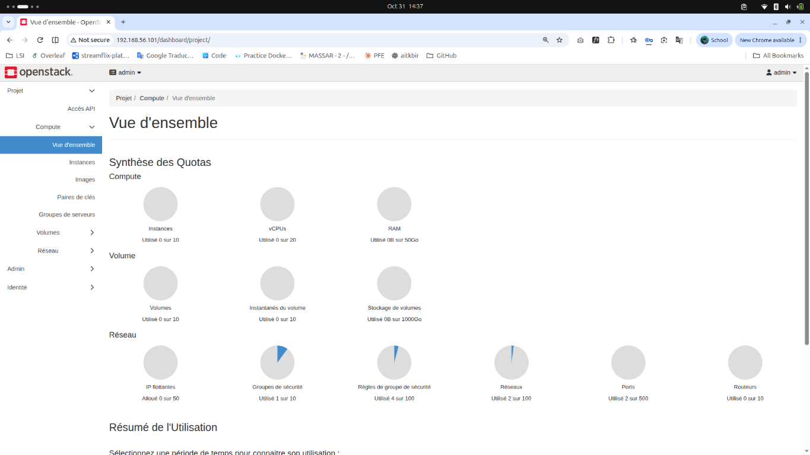

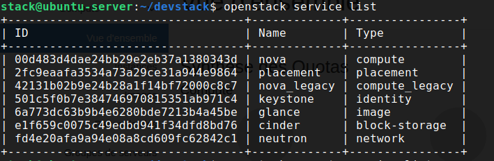

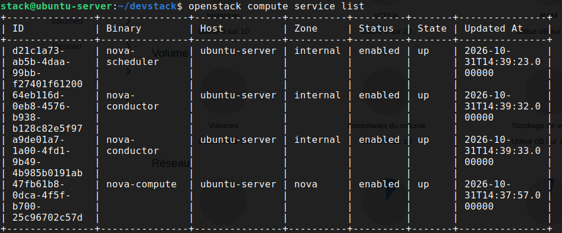

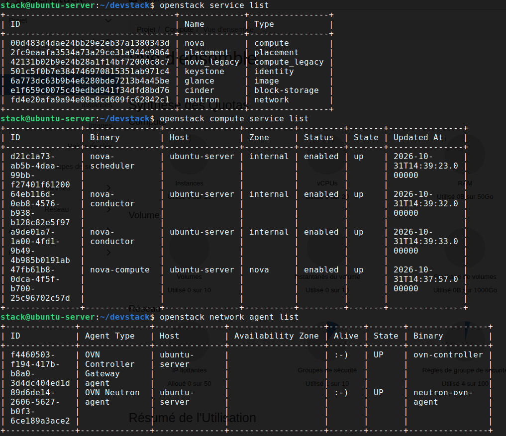

## 3.2 IaaS avec CirrOS

Le réseau privé `net-tp` utilise le sous-réseau `10.10.10.0/24`. Le routeur `router-tp` relie ce sous-réseau au réseau externe `public`. Le groupe `sg-tp` autorise ICMP et TCP/22. Une paire de clés `key-tp` sert à SSH.

Commandes principales :

```bash
openstack network create net-tp
openstack subnet create subnet-tp --network net-tp \
  --subnet-range 10.10.10.0/24 --dns-nameserver 8.8.8.8
openstack router create router-tp
openstack router set router-tp --external-gateway public
openstack router add subnet router-tp subnet-tp
openstack security group create sg-tp --description "SSH and ICMP"
openstack security group rule create --proto icmp sg-tp
openstack security group rule create --proto tcp --dst-port 22 sg-tp
openstack keypair create key-tp > ~/key-tp.pem
chmod 600 ~/key-tp.pem
openstack server create --image cirros-0.6.3-x86_64-disk \
  --flavor cirros256 --network net-tp --security-group sg-tp \
  --key-name key-tp vm-cirros
```

Après l'association de l'IP flottante `172.24.4.201`, le test réalisé depuis la VM DevStack a reçu trois réponses sur trois au ping (0 % de perte). La connexion SSH avec `cirros` a permis de confirmer le nom d'hôte `vm-cirros` et l'adresse privée `10.10.10.101/24`.

- Le **routeur** permet la communication entre le réseau privé et le réseau externe OpenStack.
- L'**IP flottante** associe une adresse du réseau externe à l'interface réseau privée de l'instance.
- Le **groupe de sécurité** filtre le trafic entrant ; ICMP et TCP/22 ont été ouverts pour les tests demandés.
- La **paire de clés** permet une authentification SSH sans mot de passe utilisateur.

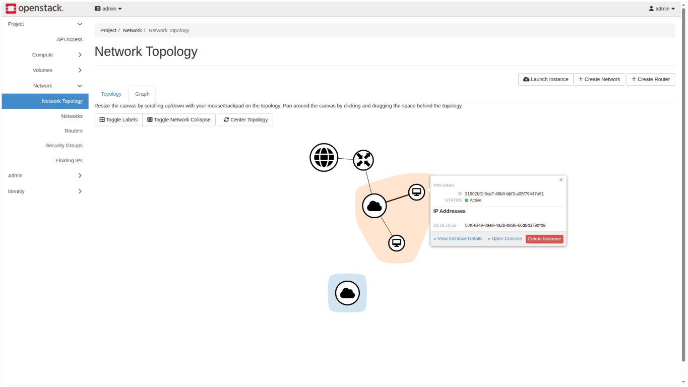

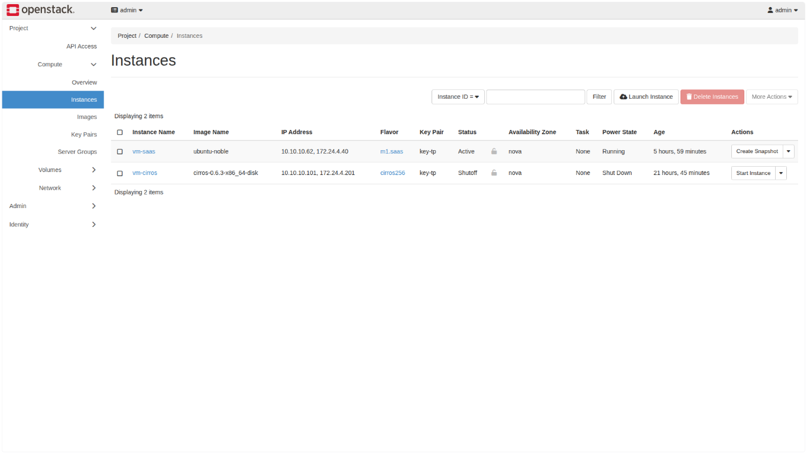

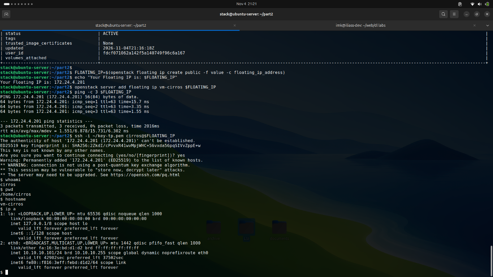

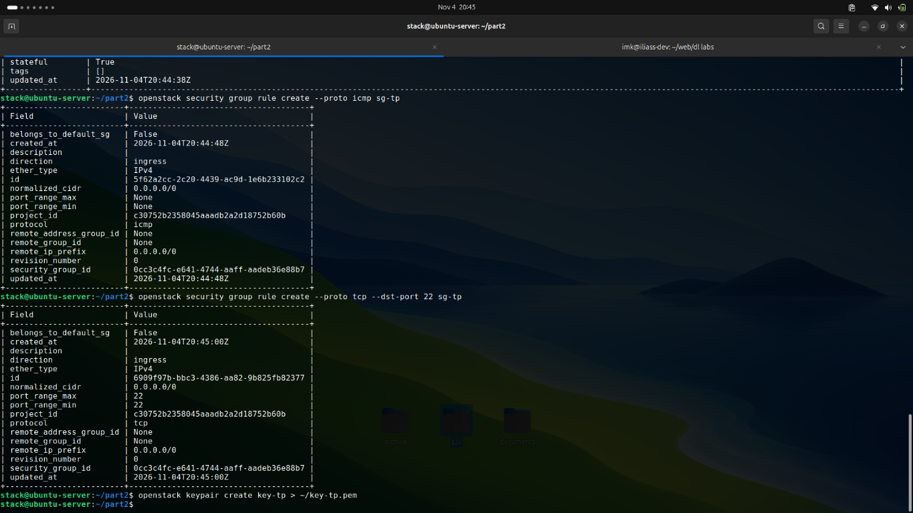

## 3.3 SaaS — application Flask sur Ubuntu

L'instance `vm-saas` utilise l'image Ubuntu 24.04 `ubuntu-noble`, le flavor `m1.saas` (1 vCPU, 1 536 MB RAM, disque 10 GB) et le réseau `net-tp`. L'adresse flottante capturée est `172.24.4.40`; l'adresse privée est `10.10.10.62`. Une règle TCP/5000 permet l'accès à l'application Flask.

Le paquet Flask a été installé à partir de paquets `.deb` téléchargés depuis la VM DevStack puis copiés avec `scp`, car les téléchargements depuis l'instance Ubuntu expiraient dans le chemin réseau utilisé. Le serveur Flask écoute sur `0.0.0.0:5000`. Depuis l'hôte, le tunnel SSH de la section 1.3 permet de l'afficher dans le navigateur à `http://localhost:8080`.

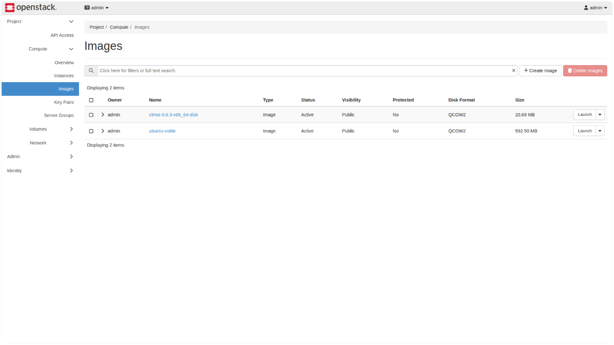

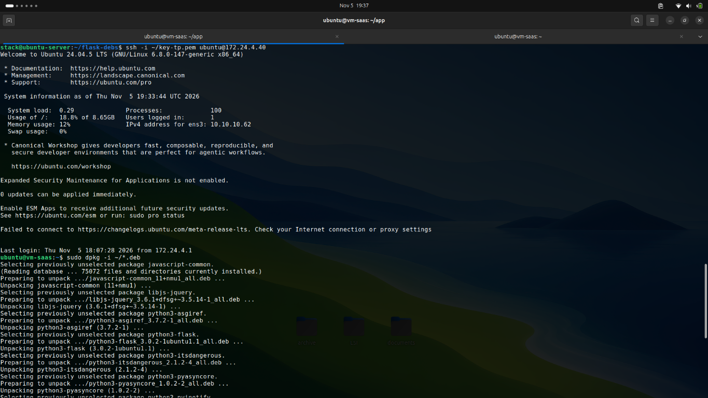

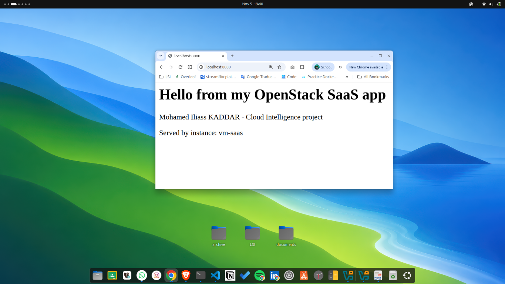

Cette application est un exemple SaaS car l'utilisateur final consomme l'application par le navigateur ; l'OS et le service Flask sont gérés dans l'instance. Pour un déploiement réel, le port applicatif et l'accès SSH devraient être restreints aux réseaux nécessaires.

# 4. Partie 3 — Infrastructure as Code avec Terraform et Ansible

## 4.1 Terraform — provisionner l'infrastructure

Terraform 1.17.1 et le provider `terraform-provider-openstack/openstack` (contrainte `>= 3.0.0`) ont été utilisés depuis la VM DevStack. Les informations d'accès sont lues dans `clouds.yaml` pour le cloud `devstack-admin` ; aucun mot de passe n'est inscrit dans les fichiers Terraform.

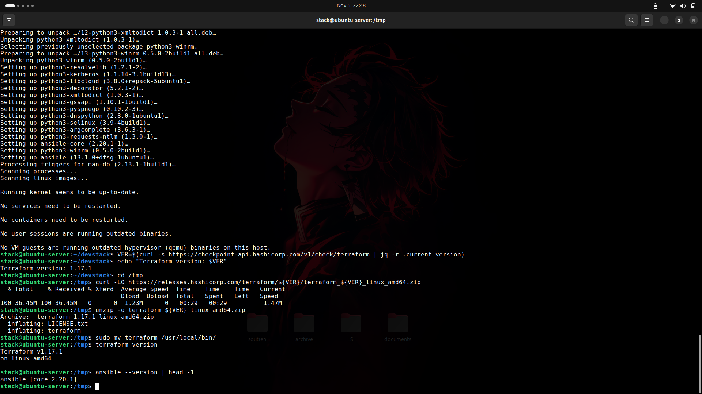

Les fichiers [`main.tf`](./scripts/part3/terraform/main.tf), [`variables.tf`](./scripts/part3/terraform/variables.tf) et [`outputs.tf`](./scripts/part3/terraform/outputs.tf) décrivent :

- le groupe de sécurité `sg-terraform` avec ingress TCP/22 et TCP/80 ;
- le port réseau sur le réseau existant `net-tp` ;
- l'instance Ubuntu `vm-terraform`, image `ubuntu-noble`, flavor `m1.saas`, clé `key-tp` ;
- une IP flottante attachée à son port ;
- les outputs du nom d'instance et de l'IP flottante.

Commandes utilisées :

```bash
cd ~/part3/terraform
terraform init
terraform validate
terraform plan
terraform apply -auto-approve
terraform destroy -auto-approve
```

Le plan initial annonce 7 ressources à créer. L'application a terminé avec 7 ressources ajoutées ; l'instance a reçu l'IP flottante `172.24.4.84`. Après un problème de disque/boot de l'instance, Terraform a remplacé uniquement l'instance avec `terraform apply -replace=openstack_compute_instance_v2.vm -auto-approve`. Une fois la page vérifiée, `terraform destroy` a supprimé les 7 ressources gérées.

Les deux règles SSH et HTTP sont ouvertes à `0.0.0.0/0` dans cet environnement de démonstration ; en production, elles devraient être limitées au réseau d'administration et aux clients nécessaires. Le réseau `net-tp` existant est lu comme une data source, au lieu d'être recréé.

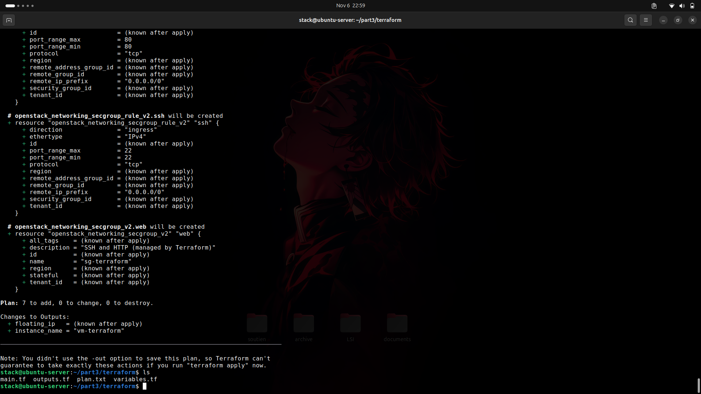

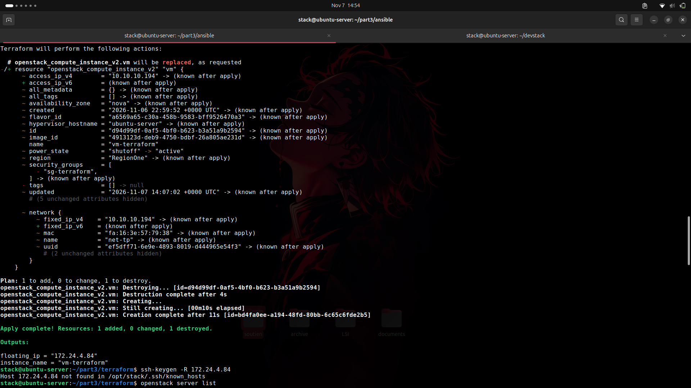

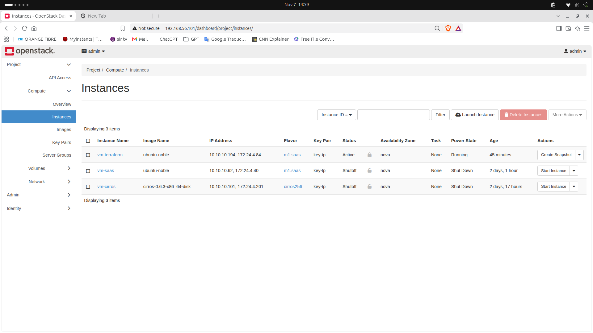

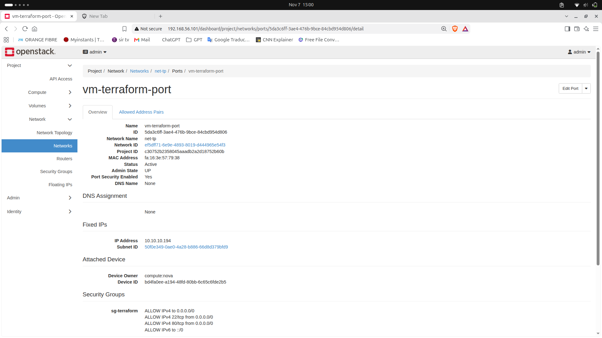

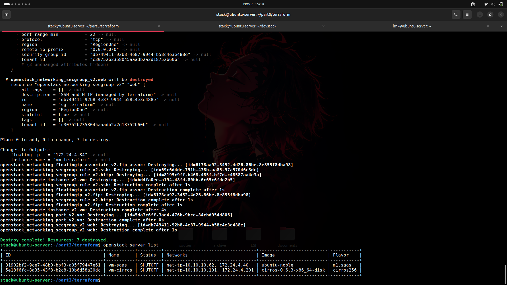

## 4.2 Ansible — configurer l'instance

Ansible Core 2.20.1 (version montrée dans la capture) a été exécuté depuis la VM DevStack. L'inventaire SSH pointe vers `vm-terraform` (`172.24.4.84`) avec l'utilisateur `ubuntu` et la clé `key-tp`. Le playbook installe Nginx, active et démarre le service, puis déploie un template HTML avec le nom **Mohamed Iliass KADDAR**, l'identifiant **imk25** et le nom de l'instance.

La sortie des trois exécutions :

| Exécution | Résultat Ansible |
|---|---|
| Première exécution | `ok=4 changed=2 unreachable=0 failed=0` |
| Deuxième exécution (ajout du proxy APT) | `ok=5 changed=1 unreachable=0 failed=0` |
| Troisième exécution | `ok=5 changed=0 unreachable=0 failed=0` |

La dernière exécution ne change aucune ressource : c'est la preuve d'idempotence attendue. Le chemin de téléchargement APT direct depuis l'instance posait problème ; un proxy `apt-cacher-ng` installé sur DevStack a permis d'installer Nginx.

**Différence entre les outils :** Terraform provisionne les ressources cloud via l'API OpenStack et garde un état ; Ansible configure le système d'exploitation via SSH. Terraform « crée la machine » et Ansible « configure les logiciels et fichiers dans la machine ».

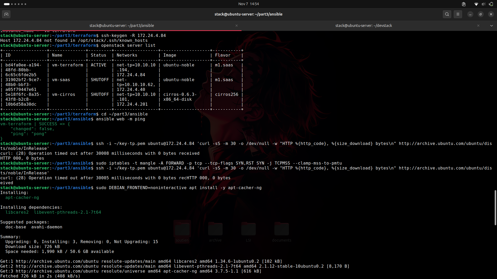

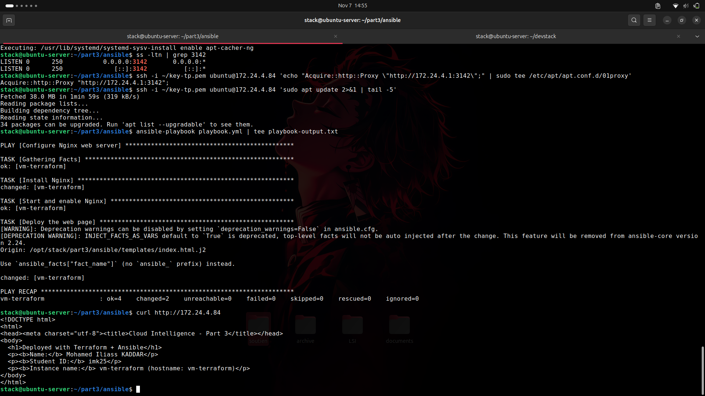

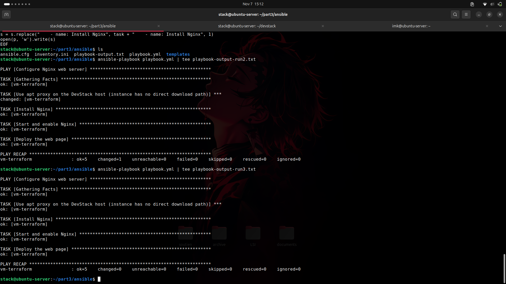

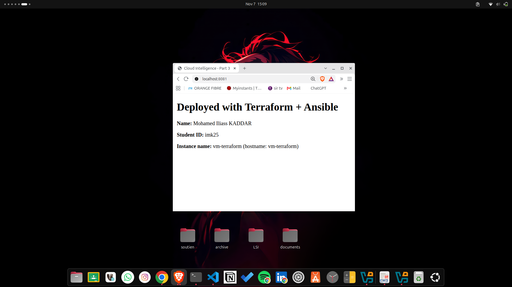

# 5. Partie 4 — SLA et surveillance de disponibilité

## 5.1 Objectif et méthode

Le fichier [`scripts/part4/sla.json`](./scripts/part4/sla.json) fixe l'objectif de disponibilité à **99,5 % par journée** pour `cirros-mon-1`, `cirros-mon-2` et `cirros-mon-3`.

Une instance est considérée disponible à une mesure si Nova la déclare `ACTIVE` **et** si son port TCP/22 répond dans un délai de trois secondes. Le script [`monitor.py`](./scripts/part4/monitor.py) utilise `openstacksdk`, s'authentifie auprès de Keystone, consulte Nova, teste SSH et ajoute ses mesures à `measurements.csv`.

La fréquence cible est une mesure toutes les cinq minutes :

```text
Disponibilité (%) = mesures disponibles / mesures totales × 100
```

Un échec de l'API OpenStack fait sauter un cycle avec un message ; il n'est pas compté comme une panne d'instance, car l'état de cette instance n'a pas été mesuré.

## 5.2 Panne contrôlée et résultats

Le test long a été exécuté pendant environ deux heures, avec 24 mesures par instance (72 lignes au total dans le CSV, hors en-tête). Une panne contrôlée de `cirros-mon-2` a été provoquée :

| Événement | Heure |
|---|---|
| Arrêt de `cirros-mon-2` | 7 novembre 2026, 21:55:13 |
| Redémarrage demandé | 7 novembre 2026, 22:10:15 |
| Détection de l'état revenu `UP` | cycle 13, vers 22:15:28 |

Au cycle 12, Nova indiquait déjà `ACTIVE`, mais le test SSH échouait encore ; le moniteur a donc gardé l'état `DOWN`. Cela illustre pourquoi l'état Nova seul ne suffit pas à vérifier l'accessibilité du service.

| Instance | Mesures | Disponibles | Échecs | Disponibilité sur l'échantillon | Objectif |
|---|---:|---:|---:|---:|---|
| `cirros-mon-1` | 24 | 24 | 0 | 100,00 % | Atteint |
| `cirros-mon-2` | 24 | 20 | 4 | 83,33 % | Non atteint |
| `cirros-mon-3` | 24 | 24 | 0 | 100,00 % | Atteint |

Le temps entre la première et la dernière mesure est environ 1 h 55 min ; le processus a été lancé avec une durée configurée de deux heures. Il s'agit d'une démonstration du fonctionnement de la mesure et de la détection, **pas d'une évaluation de SLA sur 24 heures**.

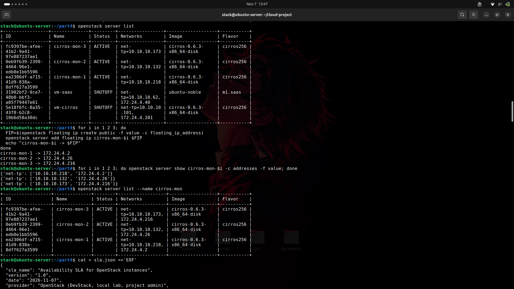

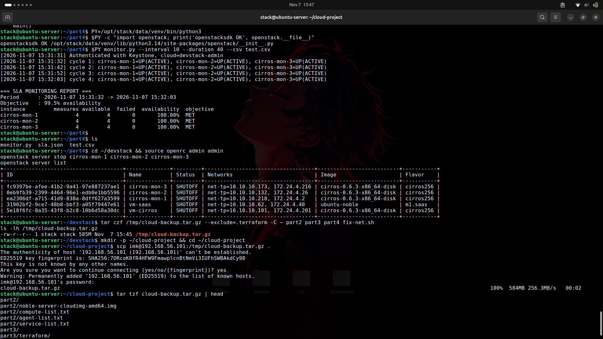

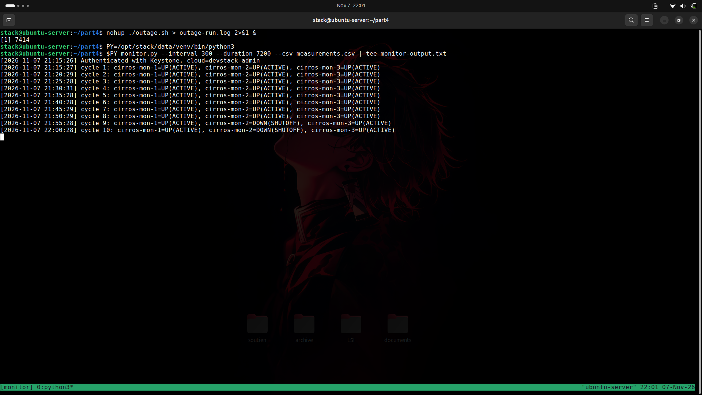

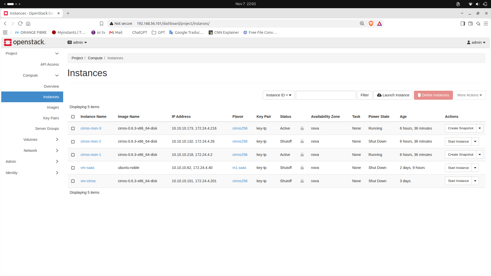

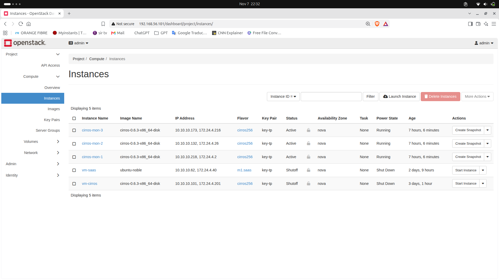

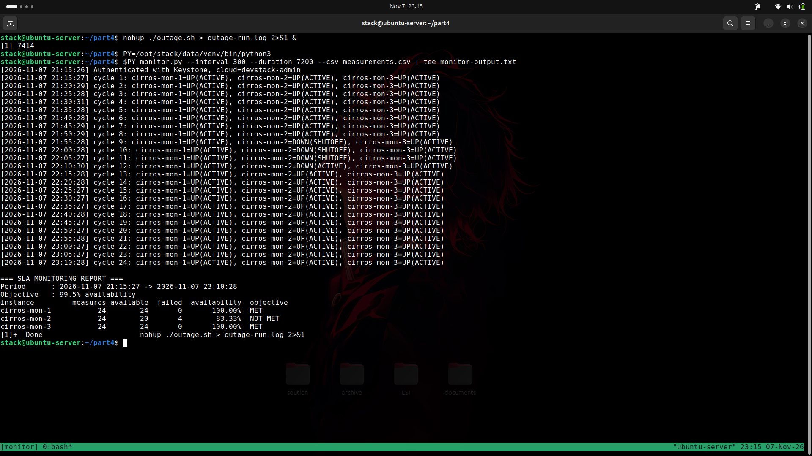

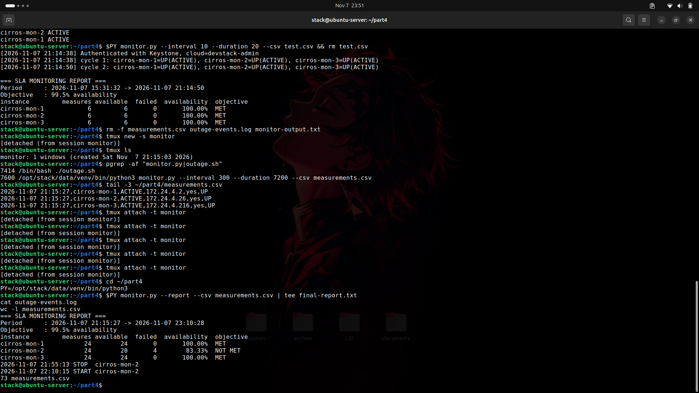

## 5.3 Question : combien d'échecs tolérer sur une journée ?

Avec un contrôle toutes les cinq minutes :

```text
24 × 60 / 5 = 288 mesures par jour et par instance
```

Le seuil de panne correspondant à 99,5 % est de 0,5 % :

- 1 échec : `287 / 288 × 100 = 99,65 %` — objectif atteint ;
- 2 échecs : `286 / 288 × 100 = 99,31 %` — objectif non atteint.

On peut donc tolérer **au plus une mesure en échec par jour** avec cet échantillonnage. Une mesure ratée correspond à environ cinq minutes de panne observée. Le budget temporel théorique de 0,5 % d'une journée vaut `24 h × 0,005 = 0,12 h`, soit **7,2 minutes**. La différence vient de l'échantillonnage discret : une mesure manquée ne localise pas exactement le début et la fin d'une panne et peut manquer une interruption située entre deux contrôles.

# 6. Vérification des captures et qualité des preuves

Les captures ont été parcourues visuellement par partie. Les noms non conformes ont été normalisés dans `screenshots/` selon le motif `p<partie>-<numéro>-<description>`.

- Le schéma exporté est maintenant [`p1-01-architecture.jpg`](./screenshots/part1-cloudsim/p1-01-architecture.jpg) ; la source modifiable reste [`architecture.drawio`](./part1-cloudsim/architecture.drawio).
- La liste des agents réseau est maintenant [`p2-11-network-agent-list.png`](./screenshots/part2-openstack/p2-11-network-agent-list.png).
- Les captures Ansible sont maintenant préfixées `p3-07` à `p3-10` : ping, playbook, idempotence, page Web.
- Les noms des événements SLA suivent le même motif `p4-01` à `p4-07`.

Les captures montrent les preuves essentielles : accès Horizon et services, ping/SSH CirrOS, application Flask, plan/apply/destroy Terraform, ping et idempotence Ansible, page déployée, état des instances SLA, panne et disponibilité finale. Néanmoins :

1. Les captures Part 2 des services de calcul et des agents réseau sont visuellement composites ; la sortie reste lisible par endroits. La capture du catalogue de services est propre, mais ne montre pas de date. Refaire ces sorties dans un terminal propre avec la date visible rendrait les preuves plus solides.
2. La capture `p4-02-monitor-test.png` contient le test rapide ainsi que des commandes et sorties ultérieures ; une capture limitée au test rapide serait plus claire.
3. Certaines captures Horizon recadrées ne montrent pas l'horloge du bureau. Les noms d'instances, l'utilisateur Horizon ou les horodatages dans les sorties sont visibles selon la capture ; avant le PDF final, vérifier que les captures retenues satisfont au mieux l'exigence de date et d'identité.

L'index des images est maintenu dans [`screenshots/README.md`](./screenshots/README.md).

# 7. Conclusion générale

Le travail met en œuvre une chaîne complète de laboratoire cloud :

- modélisation et comparaison de scénarios avec CloudSim Plus ;
- création d'un réseau, d'instances et d'une application Web dans OpenStack ;
- automatisation du provisionnement avec Terraform et de la configuration avec Ansible ;
- définition et mesure expérimentale d'un SLA de disponibilité.

Les objectifs fonctionnels des parties 2 à 4 ont été démontrés dans la VM DevStack locale : accès réseau/SSH, application Flask, site Nginx automatisé et détection d'une panne d'instance. La partie 1 compare les scénarios simulés et met en évidence un compromis entre performance et coût lorsque l'autoscaling est activé.

Les conclusions restent celles d'un laboratoire et d'hypothèses documentées. La simulation ne prouve pas une capacité réelle pour des dizaines de milliers d'utilisateurs ; le SLA observé pendant deux heures ne prouve pas un objectif quotidien ; les tarifs CloudSim ne sont pas des prix fournisseurs. Pour passer à une étude de production, il faudrait mesurer la charge réelle, effectuer des tests plus longs, analyser les pannes et valider les coûts et les emplacements auprès des parties concernées.

# Références et fichiers de preuve

1. Université Abdelmalek Essaâdi, portail officiel : [https://www.uae.ac.ma](https://www.uae.ac.ma), données conservées dans [`uae_research.md`](./scrapping-uae-data/data/uae_research.md). La collecte mentionne explicitement la vérification TLS désactivée.
2. Détails et qualité des données : [`scrapping-uae-data/data-quality/`](./scrapping-uae-data/data-quality/) et [`scrapping-uae-data/dataquality.md`](./scrapping-uae-data/dataquality.md).
3. Consigne du projet : [`projet_cloud_intelligence.md`](./projet_cloud_intelligence.md).
4. Résultats CloudSim : [`benchmark_results.csv`](./part1-cloudsim/benchmark_results.csv) et [`guide.md`](./part1-cloudsim/guide.md).
5. Commandes, scripts et sorties OpenStack/Terraform/Ansible/SLA : dossiers [`part2-openstack/`](./part2-openstack/), [`part3-iac/`](./part3-iac/), [`part4-sla/`](./part4-sla/) et [`scripts/`](./scripts/).
