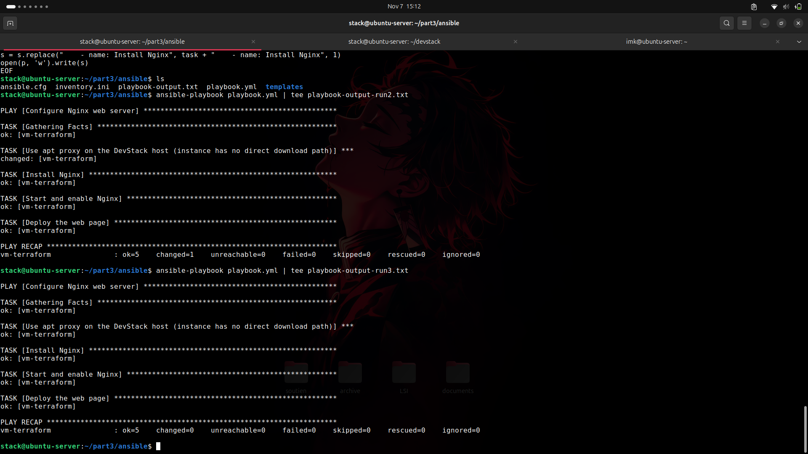

# Part 3: Infrastructure as Code (Terraform and Ansible)

**Student:** Mohamed Iliass KADDAR · **Student ID:** imk25
**Module:** Cloud Intelligence · **Prof.:** C. EL AMRANI

---

## 0. Environment

| Item | Value |
|---|---|
| Host OS | Ubuntu (laptop), VS Code |
| Hypervisor | Oracle VirtualBox (local VM) |
| DevStack VM | Ubuntu Server 26.04.1 LTS, 4 vCPU, **12 GB RAM** (raised from about 9 GB during this part), DevStack `stable/2026.2` |
| Where I ran the tools | Inside the DevStack VM (Linux), as the `stack` user |
| Terraform | official binary from releases.hashicorp.com, version: `v1.17.1` |
| Terraform provider | `terraform-provider-openstack/openstack` (>= 3.0.0), downloaded by `terraform init` |
| Ansible | installed with `apt install ansible`, version: `[core 2.20.1]` (as shown in the captured version output) |
| OpenStack credentials | read from `clouds.yaml` (cloud `devstack-admin`), **no password in any `.tf` file** |
| Nova virtualization | `virt_type = qemu` (software emulation, set in Part 2 to avoid the nested-KVM crash) |

Project folders:

```
~/part3/
├── terraform/   main.tf, variables.tf, outputs.tf, plan.txt, apply.txt, apply-rebuild.txt, destroy.txt
└── ansible/     ansible.cfg, inventory.ini, playbook.yml, templates/index.html.j2, playbook-output*.txt
```

---

## 1. Part 3.1: Terraform (provision the infrastructure)

### 1.1 Installation

```bash
sudo apt update
sudo apt install -y unzip jq curl ansible
VER=$(curl -s https://checkpoint-api.hashicorp.com/v1/check/terraform | jq -r .current_version)
cd /tmp
curl -LO https://releases.hashicorp.com/terraform/${VER}/terraform_${VER}_linux_amd64.zip
unzip -o terraform_${VER}_linux_amd64.zip
sudo mv terraform /usr/local/bin/
terraform version
```

I used the official binary instead of the HashiCorp apt repository because the repository may not support Ubuntu 26.04 yet.

### 1.2 Credentials (`clouds.yaml`)

```bash
openstack --os-cloud devstack-admin token issue -c expires -f value
```

Terraform reads the cloud by name (`cloud = "devstack-admin"`), so no secret appears in my `.tf` files.

### 1.3 Terraform files

`variables.tf`

```hcl
variable "instance_name" { default = "vm-terraform" }
variable "image_name"    { default = "ubuntu-noble" }
variable "flavor_name"   { default = "m1.saas" }
variable "network_name"  { default = "net-tp" }
variable "key_pair"      { default = "key-tp" }
variable "external_pool" { default = "public" }
```

`main.tf`

```hcl
terraform {
  required_providers {
    openstack = {
      source  = "terraform-provider-openstack/openstack"
      version = ">= 3.0.0"
    }
  }
}

# Credentials are read from clouds.yaml
provider "openstack" {
  cloud = "devstack-admin"
}

# Existing private network (created in Part 2)
data "openstack_networking_network_v2" "private" {
  name = var.network_name
}

# Security group: SSH + HTTP
resource "openstack_networking_secgroup_v2" "web" {
  name        = "sg-terraform"
  description = "SSH and HTTP (managed by Terraform)"
}

resource "openstack_networking_secgroup_rule_v2" "ssh" {
  direction         = "ingress"
  ethertype         = "IPv4"
  protocol          = "tcp"
  port_range_min    = 22
  port_range_max    = 22
  remote_ip_prefix  = "0.0.0.0/0"
  security_group_id = openstack_networking_secgroup_v2.web.id
}

resource "openstack_networking_secgroup_rule_v2" "http" {
  direction         = "ingress"
  ethertype         = "IPv4"
  protocol          = "tcp"
  port_range_min    = 80
  port_range_max    = 80
  remote_ip_prefix  = "0.0.0.0/0"
  security_group_id = openstack_networking_secgroup_v2.web.id
}

# Network port carrying the security group
resource "openstack_networking_port_v2" "vm" {
  name               = "${var.instance_name}-port"
  network_id         = data.openstack_networking_network_v2.private.id
  security_group_ids = [openstack_networking_secgroup_v2.web.id]
  admin_state_up     = true
}

# Ubuntu instance
resource "openstack_compute_instance_v2" "vm" {
  name        = var.instance_name
  image_name  = var.image_name
  flavor_name = var.flavor_name
  key_pair    = var.key_pair

  network {
    port = openstack_networking_port_v2.vm.id
  }
}

# Floating IP + association
resource "openstack_networking_floatingip_v2" "fip" {
  pool = var.external_pool
}

resource "openstack_networking_floatingip_associate_v2" "fip_assoc" {
  floating_ip = openstack_networking_floatingip_v2.fip.address
  port_id     = openstack_networking_port_v2.vm.id
}
```

`outputs.tf`

```hcl
output "instance_name" {
  value = openstack_compute_instance_v2.vm.name
}

output "floating_ip" {
  value = openstack_networking_floatingip_v2.fip.address
}
```

### 1.4 Commands and results

```bash
cd ~/part3/terraform
terraform init
terraform validate
terraform plan  | tee plan.txt
terraform apply -auto-approve | tee apply.txt
```

| Step | Result obtained |
|---|---|
| `terraform plan` | `Plan: 7 to add, 0 to change, 0 to destroy.` |
| `terraform apply` | `Apply complete! Resources: 7 added, 0 changed, 0 destroyed.` |
| Outputs | `instance_name = "vm-terraform"`, `floating_ip = "172.24.4.84"` |

The 7 resources: security group, SSH rule, HTTP rule, network port, instance, floating IP, floating IP association.

Instance rebuild (the first instance's disk got corrupted, see section 4):

```bash
terraform apply -replace=openstack_compute_instance_v2.vm -auto-approve | tee apply-rebuild.txt
```

Result: `Plan: 1 to add, 0 to change, 1 to destroy.` then `Apply complete! Resources: 1 added, 0 changed, 1 destroyed.` The floating IP stayed `172.24.4.84`.

Final cleanup (after Ansible and screenshots):

```bash
terraform destroy -auto-approve | tee destroy.txt
openstack server list
```

Result: `Destroy complete! Resources: 7 destroyed.` Only `vm-saas` and `vm-cirros` (from Part 2) remain.

---

## 2. Part 3.2: Ansible (configure the machine)

### 2.1 Files

`ansible.cfg`

```ini
[defaults]
inventory = inventory.ini
host_key_checking = False
```

`inventory.ini`

```ini
[web]
vm-terraform ansible_host=172.24.4.84 ansible_user=ubuntu ansible_ssh_private_key_file=~/key-tp.pem ansible_python_interpreter=/usr/bin/python3
```

`templates/index.html.j2`

```html
<!DOCTYPE html>
<html>
<head><meta charset="utf-8"><title>Cloud Intelligence - Part 3</title></head>
<body>
  <h1>Deployed with Terraform + Ansible</h1>
  <p><b>Name:</b> {{ student_name }}</p>
  <p><b>Student ID:</b> {{ student_id }}</p>
  <p><b>Instance name:</b> {{ instance_name }} (hostname: {{ ansible_facts['hostname'] }})</p>
</body>
</html>
```

`playbook.yml` (final version)

```yaml
---
- name: Configure Nginx web server
  hosts: web
  become: true
  vars:
    student_name: "Mohamed Iliass KADDAR"
    student_id: "imk25"
    instance_name: "vm-terraform"
  tasks:
    - name: Use apt proxy on the DevStack host (instance has no direct download path)
      ansible.builtin.copy:
        dest: /etc/apt/apt.conf.d/01proxy
        content: 'Acquire::http::Proxy "http://172.24.4.1:3142";'
        mode: "0644"

    - name: Install Nginx
      ansible.builtin.apt:
        name: nginx
        state: present
        update_cache: true

    - name: Start and enable Nginx
      ansible.builtin.service:
        name: nginx
        state: started
        enabled: true

    - name: Deploy the web page
      ansible.builtin.template:
        src: index.html.j2
        dest: /var/www/html/index.html
        mode: "0644"
```

### 2.2 Commands and results

```bash
cd ~/part3/ansible
ansible web -m ping
ansible-playbook playbook.yml | tee playbook-output.txt
curl http://172.24.4.84
```

| Step | Result obtained |
|---|---|
| `ansible web -m ping` | `vm-terraform | SUCCESS => "ping": "pong"` |
| First playbook run | `PLAY RECAP: ok=4 changed=2 unreachable=0 failed=0` (Nginx installed, page deployed) |
| `curl http://172.24.4.84` | HTML page with **Mohamed Iliass KADDAR**, **imk25** and **vm-terraform** |

After adding the apt-proxy task to the playbook, I re-ran it twice:

```bash
ansible-playbook playbook.yml | tee playbook-output-run2.txt
ansible-playbook playbook.yml | tee playbook-output-run3.txt
```

> Run 2: `ok=5 changed=1 unreachable=0 failed=0` (the proxy file is created). Run 3: `ok=5 changed=0 unreachable=0 failed=0`. This shows the playbook is **idempotent**.




## 3. Part 3.3: Terraform vs Ansible (answer for the report)

| | **Terraform** | **Ansible** |
|---|---|---|
| Role | **Provisions infrastructure**: instance, network port, security group, floating IP | **Configures machines**: installs software, manages services, deploys files |
| Works at the level of | The cloud, through the OpenStack API | The operating system, through SSH |
| Model | Declarative, keeps a **state** (`terraform.tfstate`) | Declarative tasks, **idempotent**, agentless, no state file |
| Typical commands | `init`, `plan`, `apply`, `destroy` | `ansible`, `ansible-playbook` |
| In my project | Created `vm-terraform`, `sg-terraform` and the floating IP | Turned the empty Ubuntu instance into an Nginx web server showing my identity |

**In one sentence:** Terraform builds the house (the infrastructure), and Ansible furnishes it (the software and configuration inside). They are complementary: Terraform outputs the floating IP, and that IP goes into the Ansible inventory.

---

## 4. Problems encountered and how I solved them

| # | Problem | Cause | Fix |
|---|---|---|---|
| 1 | `terraform plan` failed: `unable to load clouds.yaml ... mapping key "functional" already defined at line 89` | DevStack wrote a `clouds.yaml` with a duplicate YAML key. The `openstack` CLI tolerates it, Terraform's strict parser does not | Created a clean per-user copy in `~/.config/openstack/clouds.yaml` (only `devstack` and `devstack-admin`, mode 600). Terraform reads that location first. System file untouched |
| 2 | After `apply` (13 s), SSH said "Connection refused" for 20+ minutes. Console log frozen at `blk-availability.service` | `ACTIVE` only means the VM started, not that Ubuntu finished booting. Under qemu emulation the first boot takes 10 to 15 min, and the DevStack VM had only about 1.8 GB RAM available | Raised the DevStack VM RAM to 12 GB (5.6 GB available afterwards) |
| 3 | After a hard reboot, the instance showed `Press Enter for maintenance` (emergency mode) | The hard reboot interrupted the first boot and left the root disk inconsistent | Rebuilt only the instance with `terraform apply -replace=openstack_compute_instance_v2.vm`. Floating IP, port and security group were kept. Waited about 10 minutes without touching it. SSH then worked |
| 4 | `ansible ... ssh: connect to host ... port 22: Connection refused` (right after apply) | Same as 2: Ansible ran before sshd was up | Waited with a loop testing port 22 (`/dev/tcp/<ip>/22`), then `ansible web -m ping` returned `pong` |
| 5 | From the instance, `curl` to the Ubuntu archive timed out with 0 bytes (same problem as Part 2). An MSS-clamp iptables rule did not fix it | Large downloads from the instance stall on the path instance, OVN router, DevStack VM, VirtualBox NAT. SSH and `scp` over the internal network work fine | Installed `apt-cacher-ng` on the DevStack VM (port 3142) and pointed the instance to it with `Acquire::http::Proxy "http://172.24.4.1:3142";`. Then `apt update` (38 MB) and the Nginx install worked. Added this as the first task of the playbook so the setup is reproducible |
| 6 | Deprecation warning during the template task (`ansible_hostname`) | Ansible is moving away from injecting facts as top-level variables | Changed the template to `ansible_facts['hostname']` |

---

## 5. Final state

- Terraform infrastructure **destroyed** (`7 destroyed`). Part 2 instances (`vm-cirros`, `vm-saas`) remain, both SHUTOFF
- DevStack VM RAM: 12 GB
- `apt-cacher-ng` still installed on the DevStack VM (harmless)
- After every reboot: `~/fix-net.sh` then `source ~/devstack/openrc admin admin`

---

## 6. Deliverables checklist

- [x] `main.tf`, `variables.tf`, `outputs.tf` (no passwords)
- [x] `inventory.ini`, `playbook.yml`, `templates/index.html.j2`, `ansible.cfg`
- [x] Output of `terraform apply` (`apply.txt`), plus `plan.txt`, `destroy.txt`, `apply-rebuild.txt`
- [x] `playbook-output.txt` (and the idempotent re-run)
- [x] Screenshot of the web page (name, student ID, instance name, URL bar visible)
- [x] Record Terraform/Ansible versions and run 2/run 3 recaps.
- [x] Section 3 reworded in my own words