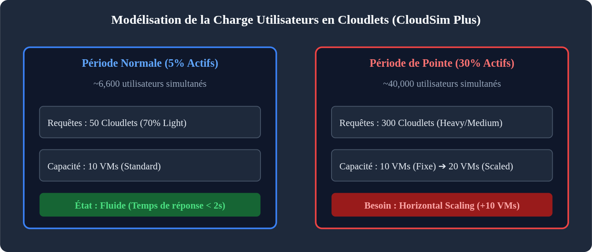

### 1. Définition des Profils de Requêtes (Types de Cloudlets)

Toutes les requêtes envoyées à la plateforme SaaS (Moodle, examens, inscriptions) n'ont pas le même poids en calcul (MIPS - *Million Instructions Per Second*) ni la même taille de données transférées. Nous modélisons **3 types de requêtes** :

| Type de Service / Requête | Description | Longueur Cloudlet (MI) | Taille Entrée / Sortie (KB) | Profil d'utilisation |
| --- | --- | --- | --- | --- |
| **REQ-LIGHT (Consultation)** | Consultation de notes, lecture de cours Moodle, affichage de planning. | **5 000 MI** | 50 KB / 150 KB | 70% des requêtes globales |
| **REQ-MEDIUM (Interactif)** | Soumission d'un devoir, envoi de formulaire d'inscription, quiz en ligne. | **20 000 MI** | 300 KB / 300 KB | 20% des requêtes globales |
| **REQ-HEAVY (Calcul/Examen)** | Validation d'examen en ligne chiffré, génération de relevé de notes PDF, traitement lourd. | **50 000 MI** | 1 000 KB / 2 000 KB | 10% des requêtes globales |

---

### 2. Modélisation des Scénarios de Simulation

Nous appliquons la concurrence active ($N = 132\ 700$ utilisateurs au total) calculée à l'Étape 1 pour simuler les deux périodes :

#### Scénario A : Période Normale (Cours habituels & Consultation)

* **Taux d'activité simultanée :** **5% des utilisateurs** connectés en même temps $\approx \mathbf{6\ 600\text{ utilisateurs simultanés}}$.
* **Volume dans CloudSim Plus :**
* Nombre de Cloudlets simulés : **50 Cloudlets** (représentatifs du ratio 70/20/10).
* Infrastructure disponible : **10 VMs actives** (5 à Tanger, 5 à Tétouan).
* Ordonnancement : `CloudletSchedulerTimeShared` (partage équitable du temps CPU entre requêtes).

#### Scénario B : Période de Pointe (Inscriptions & Examens en ligne)

* **Taux d'activité simultanée :** **30% des utilisateurs** connectés en même temps $\approx \mathbf{40\ 000\text{ utilisateurs simultanés}}$.
* **Volume dans CloudSim Plus :**
* Nombre de Cloudlets simulés : **300 Cloudlets** (forte concentration de requêtes `REQ-MEDIUM` et `REQ-HEAVY`).
* On comparera deux cas de figure :
1. **Sans Scaling (Saturation) :** 10 VMs avec `CloudletSchedulerSpaceShared` (file d'attente bloquante).
2. **Avec Scaling (Optimisé) :** Passage dynamique de **10 à 20 VMs** (via Auto-Scaling / Cloud Bursting) avec `CloudletSchedulerTimeShared`.

---

### 3. Diagramme du Flux des Cloudlets (À inclure dans le rapport)

